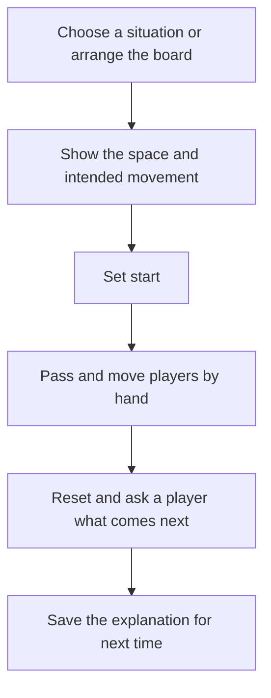

# Sideline soccer coaching and team setup plan

Prepared October 26, 2026 from the local v0.4 baseline at `77ba65d`. The user selected **teaching positioning, passing, and movement**, then requested a dedicated Coaching tab and a separate area for Team Setup and management. This records the design and original delivery sequence; the local implementation status below supersedes the earlier sequence.

Before implementation, the user required legitimate youth-soccer sources for every prebuilt coaching situation. The [coaching content standard](docs/COACHING_CONTENT_STANDARD.md) now governs selection, age fit, attribution and review. The mockup's situations and eight-item count are placeholders; they are not approved lessons.

Make Sideline the board a volunteer coach can open, use to explain one soccer idea in under a minute, and reset for a player to try. Keep 9v9 as the default and 7v7 as the secondary format. Build on the existing hands-on demonstration.

## Local implementation status

The user authorized implementation of verified sources while excluding unsourced situations. v0.5 now includes the three workspaces, five FIFA-linked native activity illustrations, teaching aids, Pass/Run arrows, local draft recovery, editable-file import/export, a personal playbook, and team/roster/lineup management. The original milestone version labels below remain planning history; these related features were implemented together for review. See [current behavior](README.md) and [verification](docs/verification/2026-10-26/README.md). The user subsequently authorized GitHub Pages publication for phone testing. Independent youth-coach, physical-device and on-field acceptance remain open.

## Three app areas

| Tab | Purpose | Main features |
| --- | --- | --- |
| Board | Arrange and demonstrate | Pitch, moving and passing, drawing, Set start, Reset, history, Save and Share |
| Coaching | Choose what and how to teach | Situations, personal playbook, coaching cues and questions, guides, focus views and player visibility |
| Team | Prepare the team and lineup | Team profile, format, formation, colors, roster, availability, starting positions and bench |

Board is the default screen. Coaching and Team are separate workspaces, reached through three persistent, labelled tabs: **Board**, **Coaching**, **Team**. Portrait phones and the tablet concept use a bottom tab bar. Compact landscape phones can use a header tab strip while retaining the existing right-hand board controls. Keep the field and controls usable at the smallest supported size.

Switching tabs preserves the active board, demo start, history, selected tool, view, and unfinished form drafts. Cancel an in-progress canvas gesture before switching. Opening a tab never applies a formation, replaces a board, or commits a roster edit. Focus moves to the selected screen and returns predictably when a dialog closes.

Coaching owns the situation browser and teaching-aid settings. **Open on board** copies a chosen situation into Board and selects that tab. The active cue can appear as a small collapsible panel on Board; the library remains in Coaching. Pass/run styles stay behind the existing Arrow control.

Team owns format, formation, colors and named-player setup. **Apply to board** previews the affected side and changes the board only after the coach applies it. A quick anonymous setup remains available for coaches who do not want a roster. Board's Menu retains help, installation and general app actions.

The [team setup plan](TEAM_PLAN.md) defines the team workflow, data boundaries and delivery steps. [Proposed screen images](docs/design/soccer-tabs/README.md) illustrate the three areas.

## The coaching experience

The coach chooses a prepared situation in Coaching and opens it on Board, or arranges a blank board directly. They select guides in Coaching, add movement marks on Board, and capture the starting setup. They move the ball and players manually, reset, and ask a player to identify the next pass or run. They can save the setup for another session and share a picture or an editable board file.

The board remains the main screen. Keep Move, Arrow, Draw, Erase, history, Set start, Reset, Save, Share, and Menu in their familiar places. Put arrow styles behind Arrow and teaching aids behind Coaching. A situation's cue and question should collapse so they do not cover the field.

## What already exists

The current implementation in `app.js`, `index.html`, `presets/`, and `sw.js` provides:

- Two formations each for 9v9 and 7v7, position labels, and individual position or number editing.
- Player and ball dragging, animated tap-to-pass, possession changes, freehand drawing, straight arrows, and erasing.
- Undo and redo, Set start, repeatable demonstration Reset, and a separate formation reset.
- Five named local saves, PNG sharing, responsive orientation, and a cached offline app shell.

The main gaps for teaching are that every arrow means the same thing, both teams share a formation choice, all players compete for attention, and the field has no optional spacing guides or prepared teaching situations. Save uses a browser naming prompt; there is no automatic draft recovery or editable backup. Physical iPhone and iPad acceptance remains open in `README.md`.

## Teaching choices

U.S. Soccer's guides emphasize roles in attack, defense, and transition, questions that engage players, and opportunities to experience different positions. The U11–U12 guide also emphasizes space, positioning, and combinations in small groups. Use these as the basis for the situations and questions; the features below are our product choices. [U9–U10 coaching guide](https://www.ussoccer.com/us-way/player-development/environment/age-group-guide/u9-u10), [U11–U12 coaching guide](https://www.ussoccer.com/us-way/player-development/environment/age-group-guide/u11-u12).

These development guides provide curriculum context, not proof of the specific diagrams in the concepts. Each bundled situation also needs a concrete published youth activity and a reviewed record of our adaptation. Keep the original activity's ages and player count visible; a board preset does not establish lesson suitability.

- **Teach one idea at a time.** Each situation has one short cue and one question. Avoid long coaching articles over the board.
- **Explain roles through movement.** Position labels describe a starting responsibility; guides show useful spaces without preventing a player from moving elsewhere.
- **Separate the ball from the runner.** Pass and run marks use different patterns and an on-board legend. Color alone must not carry the distinction.
- **Let the coach demonstrate and the player answer.** Keep manual movement and Reset central. Prepared situations supply starting points, not mandatory solutions.
- **Keep field guidance configurable.** Field size and player count can vary in youth football under the governing rules. Treat the pitch as a schematic; any future league-specific guide needs that competition's source and season before becoming a default. [IFAB general modifications](https://www.theifab.com/laws/latest/general-modifications/).

## Delivery sequence

Version labels below describe the proposed coaching milestones, with acceptance at each stage rather than fixed calendar dates. Coordinate final app version numbers with the Team work; the two tracks share navigation, storage and board application.

### First release v0.5 Clear demonstrations and reliable recovery

Deliver an immediate soccer improvement alongside the ability to keep the work.

0. **S00 Add the Board, Coaching and Team navigation.** Build the three workspace shells first. Keep Board as the default and move setup controls to Team without requiring a roster. Coaching initially contains the teaching-aid entry point and an explanation of the planned library. Tab changes preserve the board and its Undo history; incomplete canvas gestures are cancelled cleanly. Add Team profile and roster features in the sequence in `TEAM_PLAN.md`.
1. **S01 Add Pass and Run arrow styles.** Use a solid line for the ball path and a dashed line for a player's run, with a small legend whenever either appears. Keep the existing Arrow gesture and remember the selected style. Legacy arrows retain their current appearance without acquiring an inferred soccer meaning. Freehand drawing stays available; curved routes and dribbling marks can wait for observed demand.
2. **S02 Replace the save prompt and recover the current draft.** Use an app dialog for naming, renaming, replacing, and cancelling saves. Keep five named slots for this release. Automatically save the current board and demo start after completed actions, with a visible saved/error state. A draft is separate from named saves; format changes, Open, and both Reset actions update the draft to their resulting state. On startup, restore the last completed draft. Cancelled gestures and unfinished edits never become recovered state.
3. **S03 Export and import an editable board.** Add a versioned board file beside PNG sharing. Include format, player identities and labels, ball, drawings, colors, and demo start. Validate the entire file before replacing the active board, including recognized formats, finite coordinates, valid carrier references, and bounded file/object sizes. Reject unsupported newer versions clearly and offer cancellation. Export must remain usable when local saving fails. Report a successful save only after its storage transaction completes.

**Acceptance:** Switch among all three tabs and return to the exact board, demo start and Undo history. Explain a pass followed by a supporting run, Reset, and repeat without changing tools unexpectedly. The two marks remain distinguishable on screen and in a PNG. Reload after editing and recover the last completed state. Export a labeled board with a demo start, import it into fresh storage, and demonstrate it again. Simulated write failures must never produce a false saved message or destroy the active board. Complete the real-device checks below before releasing this milestone.

### Second release v0.6 Make space and team shape easier to see

1. **S04 Add optional spacing guides in Coaching.** Offer horizontal thirds and three width channels, off by default. Use one lightweight guide selector and retain labels when the field rotates. Guides are teaching overlays, not boundaries that constrain movement. Defer build-out and offside guides until the target league and teaching need are established.
2. **S05 Add focus views and player visibility in Coaching.** Offer Full field, Attacking half, and Defending half relative to the selected teaching team. Allow hiding the opponent team or individual markers for a small-group explanation. Hidden markers retain their identity and position but cannot receive taps or passes. If a carrier is hidden, leave the ball loose at its last field position. Cropping never deletes or moves markers outside the view. Keep a quick Full field control on Board so the coach can recover an off-screen ball or marker.
3. **S06 Give each team its own shape in Team and direction cue on Board.** Choose Home or Away before applying a formation, preserving the other team's arrangement, existing drawings, and both teams' marker labels and numbers. A carried ball follows its stable carrier; a loose ball stays in place. Show a clear attacking-direction cue for each team. Keep an explicitly named Reset both teams action that restores default positions and labels. Repositioning a team clears the current demo start; ordinary visibility or view changes do not. All board changes remain undoable. Named roster lineups use the explicit application rules in `TEAM_PLAN.md`.

**Acceptance:** Compare a 9v9 3-3-2 against a 3-2-3 without rebuilding the first team. Explain width, then isolate a 2v1, pass and move, Reset, and return to the full board. Verify player dragging, erasing, ball ownership, labels, and direction cues in both orientations and every focus view. Undo must restore shape, visibility, and any cleared demo start exactly. PNG output should match the selected teaching view with its guide and arrow legends.

### Third release v0.7 Open a useful soccer situation quickly

**S07 Add a small library derived from published youth lessons.** Choose only entries that pass the [content standard](docs/COACHING_CONTENT_STANDARD.md). The following eight ideas are candidate needs to investigate; the actual titles, count, ages and formats follow the verified sources. Do not force a 7v7 and 9v9 version of each activity.

| Candidate need | Main idea | Draft question for source review |
| --- | --- | --- |
| Find your starting shape | Recognize roles and nearby support | Who can help you if you get the ball? |
| Give the ball carrier width | Move into usable space | Where could you move to make a clearer pass? |
| Make a passing triangle | Offer more than one passing option | Where could the next supporting player stand? |
| Pass and support | Move again after releasing the ball | Where can you help after that pass? |
| Play out from the goalkeeper | Offer a short option and supporting option | Who can help the first receiver? |
| Use a 2v1 | Draw a defender and find the free player | When would you pass and when would you carry it? |
| Defend together | Coordinate pressure and cover | Who helps behind the first defender? |
| React when possession changes | Find the next attacking or defending role | What is your first useful move now? |

The [source review](docs/research/YOUTH_SOCCER_ACTIVITY_SOURCES.md) found seven candidate activities across six FIFA and FA publications. Its A01/A02 support investigating pass-and-move and width; A03/A04 cover possession and passing options; A05 covers a U-10 2v1 progression; A06 covers paired defending for the FA's 7–11 programme; A07 covers a simple transition for ages 5–11. These are research directions, not approved equivalents of the eight draft ideas. Starting formations, the exact triangle arrangement and goalkeeper build-out remain unsourced here and must be deferred. Start the first paper adaptation with A01, FIFA's ages 8–12 Give and go, preserving its native activity conditions.

Each entry contains its title, intended age range, original activity size, board format, starting board, suggested view and guides, cue, question, demo start, and Source and adaptation details. Record the exact lesson, publisher, source link and changes made for Sideline. Distinguish the source's coaching points from questions or wording we create. Use hidden markers when they help isolate a concept while retaining the source's important decisions and pressure. List these entries in Coaching under Situations, beside My playbook, with age and activity-size filters separate from board format. **Open on board** protects an unsaved draft, creates an editable copy on Board, selects that tab, and returns to Move. Use anonymous role markers by default; applying a named team is a separate explicit step. Reset returns to that situation's captured start. Saving a personal version retains its provenance and never modifies the bundled original. Cache the approved library and its reference metadata for offline use.

Use a verified source and a documented adaptation as the basis for each implemented activity. The user authorized the five FIFA-linked illustrations while independent coaching acceptance remains pending. A named coach with relevant youth-teaching experience should assess each adaptation's age fit, retained learning objective, arrangement, cue and question before we describe it as a fully reviewed lesson. Record applicable reuse and attribution. Formation examples are options rather than claims that one shape is correct for all teams. The [implementation source notes](docs/research/IMPLEMENTATION_SOURCE_NOTES.md) identify the selected source facts and our adaptations.

**Acceptance:** Every bundled entry has a completed source/adaptation record, stated ages and original activity size, named youth-coach review and resolved reuse basis. Unsupported topics and unreviewed conversions are absent. From opening the app, find a suitable situation and begin a useful demonstration within 30 seconds. Its source details are available offline, the cue can be hidden, and the coach can adapt the arrangement. No hidden marker can unexpectedly receive possession. A player should be able to identify or show a plausible next action and try the concept on the field after the explanation; a board demonstration alone is not proof of skill development.

### Fourth release v0.8 Build a personal teaching playbook

1. **S08 Replace the five-slot list with My playbook in Coaching.** Show thumbnails, names, format, topic, and favorite status. Support save, rename, duplicate, delete, and simple name/topic filtering. Migrate all five existing slots without losing their names, labels, positions, or demo starts. Preserve the original records until migration succeeds. Keep bundled situations distinct from personal copies. Board's Save action saves the current explanation into this playbook.
2. **S09 Make reuse and sharing clear.** Export one board or the complete playbook as editable files. Import previews its contents and creates copies rather than silently overwriting existing boards. Offer PNG sharing with an optional title and short coaching cue. Store teaching preferences with Coaching; team format, colors and roster defaults belong to Team.

**Acceptance:** Load a representative collection of 30 personal boards on the target phone and find the intended one within 10 seconds. Migrate populated legacy slots, export the playbook, restore into empty storage, and compare all board content and demo starts. Check native file sharing/import on iPhone and iPad as well as desktop downloads. Local storage remains a convenience; exported files are the recoverable backup.

## Implementation boundaries

Keep the dependency-free static PWA and single canvas. Continue serving from GitHub Pages with relative asset paths and offline support. Do not introduce accounts, a backend, or a framework migration to deliver this plan.

- Add a versioned board codec shared by storage and file import/export. Migrate legacy labels, generic arrows, and the single formation property without changing saved coordinates. The old formation initializes both teams' formation metadata.
- Keep team formation metadata, visibility, guides, and the teaching team in board state. Save the preferred focus view with the board; it must not rewrite world coordinates. History, Set start, Reset, storage, and exports must agree on the new state.
- Use a single forward/inverse coordinate transform for full and half-field rendering and pointer input. Keep screen rotation separate from each team's attack direction. Do not change hit testing only in the renderer.
- Treat each completed board edit as one history and draft-save action. Persist after commit, not for every pointer movement. Export the settled ball position even if its on-screen pass animation is still running.
- Keep formations in soccer presets and situations in a small data registry, separate from control code. Maintain agreement between the existing JSON sources and their runtime JavaScript copies.
- Keep navigation state and workspace form drafts separate from board content, team records and saved explanations. The preferred focus view remains part of the saved board. A tab click is not a board edit. Team edits affect saved board snapshots only through explicit application.
- Extract storage/serialization and coordinate logic only where these changes need a clear boundary. Keep unrelated code stable. Add new runtime files to the offline list and bump the service-worker cache for every runtime release.

## Verification and release gates

**Automated and browser checks:** Retain the existing board and offline tests. Add behavior checks for each new invariant: legacy migrations and import rejection; transaction failure and draft recovery; semantic arrows through Undo/Reset/save/export; independent formations; hidden possession; inverse coordinates in focus views; and bundled situations available offline. Browser checks cover dialogs, keyboard focus and cancellation, small-screen layout, orientation changes, and rendering/export agreement. Runtime checks must identify the exact commit and cache version tested.

**Physical device checks:** Use an actual iPhone and iPad with Safari and a Home Screen install. Cover one-handed use outdoors, tap/drag/hold separation, keyboard and dialog bounds, portrait/landscape changes, background/relaunch recovery, airplane-mode startup, native PNG and board-file sharing/import, and a service-worker update with existing saved content. Browser emulation does not complete these checks.

**Teaching checks:** Observe three volunteer coaches completing five prompted explanations. Proposed target: each coach completes at least four without help, begins demonstrating within 30 seconds, and can repeat with Reset within 10 seconds. With a coach and an appropriate small group, check whether players can point to or demonstrate a sensible next pass, space, or run after a one-minute explanation. Record confusion and incorrect interpretations before adding more content. These are proposed acceptance targets, not measured results.

**Content checks:** Trace each activity's objective to a specific youth lesson, verify source ages and actual group size, retain qualifications and record reuse/attribution. The five implemented source-linked illustrations meet the source-verification stage authorized by the user. Named youth-coach review and on-field acceptance of the exact Sideline adaptations remain separate, incomplete checks. Curriculum links, AI-generated diagrams and app tests do not establish teaching acceptance.

Release one milestone at a time. Resolve gesture, recovery, and explanation failures before expanding the next milestone. Record human acceptance separately from automated test results.

## Later options

Consider curved runs, a dribbling mark, group movement, highlighted support areas, and throw-in/corner/goal-kick situations when coaches repeatedly need them. Consider 4v4 and 11v11 only after validating marker size, touch overlap, field markings, role labels, and relevant local rules. A later small-group practice extension could add cones and target goals while reusing the board.

Rosters and planned starting lineups are now included in the separate Team Setup track at the user's request. Live substitution tracking, match clocks, scorekeeping, full practice scheduling, animation timelines, video, AI, accounts, subscriptions, cloud sync, and other sports remain later product decisions.

## Original sequence and next acceptance work

The original order was navigation and recovery, demonstrations and files, then team setup and the sourced coaching library. v0.5 implements that scope together under the user's implementation go-ahead. Automated, browser and deployment verification is recorded in [the implementation checks](docs/verification/2026-10-26/README.md). Next acceptance work is physical-phone/tablet use, independent youth-coach review and on-field observation. Add further prebuilt content only from specific verified youth lessons, with explicit adaptation records and visible source details.
