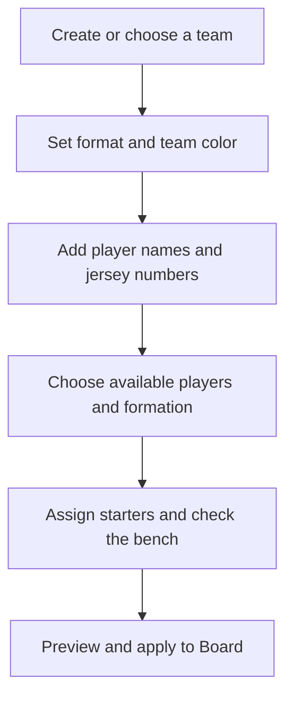

# Sideline team setup and management plan

Prepared October 26, 2026 from the v0.4 prototype. The **Team** tab was requested alongside the separate Coaching area; this plan defines the roster and planned-lineup scope implemented locally in v0.5.

Local implementation update: v0.5 now provides team profiles/copies, roster editing and optional roles, availability, starting assignments and bench, named lineups, explicit undoable application, and team-file backup/import. Source coaching activities remain separate from roster setup. See [current behavior](README.md) and [verification](docs/verification/2026-10-26/README.md); physical-device and coach acceptance are still pending. The sections below preserve the design and acceptance criteria.

Help a volunteer coach prepare a team once, assign players to a starting shape, keep a clear bench list, and explicitly send that lineup to the soccer board. Team setup should support the teaching workflow without changing an explanation while it is in progress. See the [coaching and navigation plan](SOCCER_PLAN.md) and [screen concepts](docs/design/soccer-tabs/README.md).

## Team workflow

The coach creates a team profile, selects 7v7 or 9v9 and a color, and adds first names or nicknames, jersey numbers, and optional roles to try. They choose who is available for the current lineup, assign starters to formation slots, and review the remaining players on the bench. **Apply to board** previews the selected side before replacing its setup. Saving a team or changing a tab never applies a lineup automatically.

## Team screens

| Area | Contents and actions |
| --- | --- |
| Team settings | Team name, default format, color, preferred formation, optional second color |
| Roster | Add, edit and remove players; name, jersey number and optional roles to try |
| Lineup | Formation, availability for this lineup, starting assignments and bench |
| Team files | Export and import a team with its saved lineups |

On phones, use a team header with Roster and Lineup subviews. The global tabs remain Board, Coaching and Team. On a tablet, show roster and lineup side by side. A Team settings button opens profile details without replacing the navigation. Make manual assignment work by tapping a position and choosing a player; dragging can be an additional shortcut.

A quick anonymous setup supports the existing board workflow without creating a team. It offers format, independent Home/Away formations and colors. Move these existing settings from Board's Menu into Team when the tab shell ships.

## Player and lineup behavior

- Start with one local team. Add multiple local team profiles after the create, edit and apply flow is proven. No sign-in is required.
- Give each player a stable internal identity. Renaming a player or changing their jersey number must retain their lineup assignments. Display names live in Team; the board continues to offer position or number labels.
- Accept jersey numbers 0–99, consistent with the board. Before applying a named lineup, require names and valid unique jersey numbers for the selected starters. Let incomplete setup remain a clearly marked draft.
- Roles to try help assignment but do not lock a child to a position. Coaches choose all assignments; the first version does not infer a player's ability or rank them.
- Availability belongs to the current lineup, separate from membership in the roster. An unavailable player cannot occupy a starting slot. Starting a fresh lineup defaults players to available and asks the coach to review availability.
- In 9v9, allow at most nine starting players including one goalkeeper; in 7v7, at most seven including one goalkeeper. Eligible available players not assigned to the field appear on the bench. Unavailable players are listed separately from the bench.
- A player can occupy only one starting slot. Reassigning an occupied slot offers a clear swap or sends the previous starter to the bench; it never silently drops a player from the roster.
- Show counts such as **9 starting · 3 bench**. If fewer players are available, identify empty slots and offer an explicitly labelled short-handed setup. Never create duplicate players to fill the shape.
- Changing format or formation previews reassignment. Preserve compatible assignments where the coach accepts them and surface every unassigned slot. Never silently remove roster members when moving from 9v9 to 7v7.
- Removing a player affects the team and future lineups after confirmation. Previously saved boards and demonstrations keep their captured names, labels and positions.

## Applying a team to the board

1. Save the lineup draft and validate its slots, player references, numbers and availability.
2. Preview the target side, Home by default, and the format, formation, starters and bench counts. Offer Cancel and **Apply to board**.
3. If the board already has the same format, replace only the selected team's markers, color and team title. Preserve the other team's setup and existing drawings. A carried ball on the changed side stays with the same person if they remain a starter; otherwise leave it loose at its last location.
4. If the formats differ, explain that this creates a fresh board for the new format and clears drawings. Allow cancellation. Apply the chosen lineup and a generic opposing shape together.
5. Applying a lineup clears the old demo start so Reset cannot unexpectedly restore a different lineup. Offer Set start on the resulting Board. Select Move, stop any in-flight ball animation, and keep the whole operation undoable, including a cross-format application.
6. Open Board with the applied lineup. Later Team edits do not update that board until another explicit application. Undo restores the previous board, demo start and team snapshots without rolling back the team record itself.

An anonymous Coaching situation opens with anonymous role markers. A later **Use my lineup** action can preview assignments against that situation's format and shape. It uses the same application path; choosing a situation never silently reassigns named players or overwrites team settings.

## Data and persistence

Keep the static offline PWA. Use local IndexedDB with the board codec and recovery work from the coaching plan.

| Record | Responsibility |
| --- | --- |
| Team profile | Stable team ID, name, default format, colors and preferred formation |
| Roster player | Stable player ID, team ID, display name, jersey number and optional roles |
| Saved lineup | Stable lineup ID, team ID, format, formation, slot assignments and availability |
| Board snapshot | Exact marker state, applied team/player identity snapshots, labels, colors, drawings, ball and demo start |
| Workspace state | Active tab, selected team/lineup and recoverable form drafts |

Store names or nicknames and jersey numbers needed for coaching; contact details and medical records are outside this setup flow. Board snapshots are self-contained so changing or deleting a team does not break older saved explanations. Imports create new local identities and preserve references within the imported file; they must not merge players solely because names match.

Report saved status after the transaction completes. Preserve incomplete form drafts when switching tabs, but do not treat them as applied team data. If a write fails, keep the visible draft and offer retry or export. A team-file export includes its roster and saved lineups; board/playbook exports include their captured team information without depending on the current roster database. Provide a preview and validation before importing.

## Delivery steps

The shared prerequisite is S00 navigation plus S02 recovery and S03 validated import/export from `SOCCER_PLAN.md`. Keep one shared formation and persistence model; the Team work must not duplicate those systems.

| Work item | Deliverable | Acceptance |
| --- | --- | --- |
| T01 Team profile and roster | One team, profile settings and player editing | Edit names and numbers, switch tabs, relaunch, and recover the intended draft or saved state without changing Board |
| T02 Lineup and bench | 7v7/9v9 slots, formation, availability and manual assignment | Prepare 12 available players as nine starters and three bench players; swap a starter; mark a player unavailable; keep all counts and references correct |
| T03 Explicit board application | Preview, target side, format change and Undo | Apply a lineup without disturbing the opposite side at the same format; cancel without changes; test cross-format application and restore the entire prior board with Undo |
| T04 Team backup and compatibility | Team-file import/export and snapshot migration | Restore a roster and lineup into empty storage, preserve saved-board snapshots after roster edits, and recover cleanly from invalid input or failed writes |
| T05 Multiple teams and reusable lineups | Team switcher, named lineups and duplication | Switching between two teams never mixes assignments, colors, drafts, or board snapshots; editing a copied lineup leaves its original intact |

Deliver T01–T04 before treating named-team setup as complete. T05 can follow observed use of one team. The separate Coaching situation library does not depend on named rosters.

## Verification

Automated checks cover stable identity through edits, duplicate/invalid numbers, assignment uniqueness, availability, goalkeeper and short-handed handling, format changes, import/export, transaction failure, legacy anonymous boards, and board snapshots that survive team deletion. Test the explicit apply operation as one undoable board edit.

Browser checks cover tab preservation, draft versus saved status, keyboard focus, validation, small portrait screens, compact landscape layout and tablet split views. Device acceptance uses physical iPhone and iPad hardware for roster typing, tapping assignments, relaunch recovery, offline use and native team-file import/export.

Proposed usability target: a coach with twelve players already entered can prepare a nine-player lineup, identify the three bench players, apply it to Board and Set start without help in under two minutes. Observe this separately from teaching acceptance; no such test has been completed by these mockups.

## Scope after setup

Live substitution schedules and minute tracking, match clocks, attendance messaging, scorekeeping, accounts, shared cloud rosters and parent portals remain later choices. The first team-management release prepares players and a lineup for the board.
