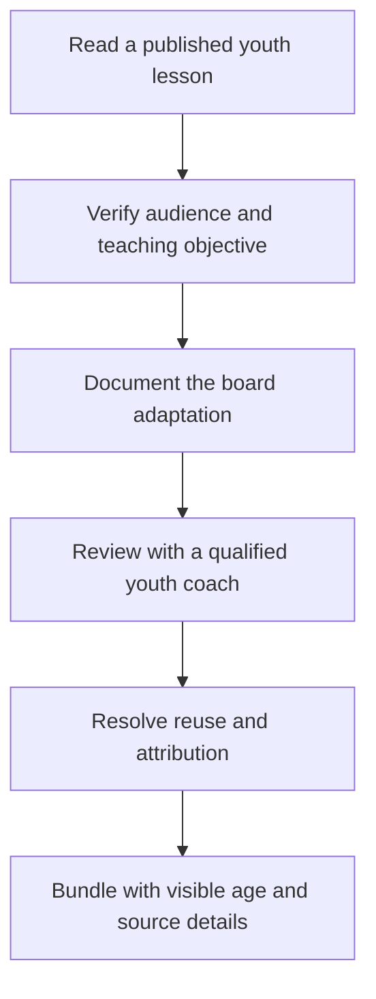

# Sideline youth coaching content standard

Established October 26, 2026 at the user's request, before implementation of the proposed features. Every bundled coaching situation must trace to a legitimate published youth-soccer activity or lesson. The concept images and original eight topic ideas are design placeholders, not an approved curriculum.

## Implementation authorization and present status

The user subsequently authorized implementation using the verified youth sources and excluding unsourced situations. The local v0.5 pack implements A01–A05 as original source-linked board illustrations. The source facts and native conditions were checked before implementation; independent youth-coach and on-field acceptance of Sideline's exact illustrations remain pending and are stated in the app's source details. This implementation authorization replaces the earlier project-authored stop-before-code sequence; it does not assert a completed coach review or publisher endorsement.

The [implementation source notes](research/IMPLEMENTATION_SOURCE_NOTES.md) record the factual setups, original copy and FIFA's attributed-link/non-commercial-display provisions. No publisher diagrams, logos, screenshots, videos or full lesson text are bundled. A06/A07 remain outside runtime pending separate reuse/link handling. Any later commercial use or broader source reuse needs its own review.

## Source requirements

Use first-party teaching material from a football federation, its coaching-education programme, a recognized youth-soccer association, or a comparably accountable coach-education organization. Confirm the publisher and credited author from the source itself. A familiar logo, a search result, an AI-generated explanation, a third-party drill collection, or an adult professional example is insufficient on its own.

Read the actual activity, including its setup, learning objectives, coaching points, progressions and qualifications. Record its exact title, publisher, credited author if given, direct link, publication date or undated status, relevant section or PDF page, and date checked. If age information comes from the publisher's session index, record that index as well as the lesson.

A general development guide supports our teaching approach, but does not validate a particular arrangement or scripted movement. A rules source supports rules, not the educational quality of a lesson. Use a concrete published youth activity as the content basis for each prebuilt.

## Age and teaching fit

U.S. Soccer's U9–U10 guide includes small-sided play through 7v7 and roles in attack, defense and transition. Its U11–U12 guide includes small-sided play through 9v9, combinations, 2v1 decisions and understanding space. Both include player questions and experience across positions. Use these guides to check developmental fit, not to imply that every child of an age has the same needs. [U9–U10 guide](https://www.ussoccer.com/us-way/player-development/environment/age-group-guide/u9-u10), [U11–U12 guide](https://www.ussoccer.com/us-way/player-development/environment/age-group-guide/u11-u12).

Preserve the published activity's age range and actual group size. A source for ages 7–11 does not automatically cover U12. A 2v1 or 5v5 activity shown on our 9v9 canvas remains a small-group illustration; it is not a source-approved 9v9 lesson. Add an age filter and show activity size separately from the board's field format. Do not infer lesson suitability solely from a team's format.

Keep the teaching objective, available choices and relevant defensive pressure. Displaying one possible pass or run must not turn an open decision into the only correct answer. Record what is lost when a live activity becomes a static board example. Do not add unsupported technical, physical or safety instructions. Exclude heading variations from the initial pack and preserve applicable age restrictions when considering later activities.

The board is a brief explanation before players try the idea on the field. U.S. Soccer's Play-Practice-Play guidance emphasizes game-like activities, player decisions, and returning to play; it does not establish that a diagram alone teaches the skill. Evaluate understanding through an appropriate on-field activity as well as use of the app. [Five Things to Know About Play-Practice-Play](https://www.ussoccer.com/stories/2018/02/five-things-to-know-about-playpracticeplay), sections describing the practice and final play phases, February 27, 2018.

## Adaptation record for every prebuilt

Before a situation enters the bundled library, complete this record in the project's coaching-content notes. Keep source facts separate from our decisions.

| Required field | What to record |
| --- | --- |
| Source identity | Exact activity title, publisher, credited author, direct URL, date and section/page |
| Source audience | Published ages, ability context where specified, player numbers, space and equipment |
| Original teaching purpose | Learning objective, important coaching points, decision being practised and relevant qualifications |
| Sideline adaptation | Selected moment, retained players, altered space or rules, omitted movement/equipment and why |
| Cue and question | Source-derived coaching point in our words; identify any question we write ourselves |
| Intended audience | Our selected ages and context, with the evidence for any narrowing or extension |
| Board format | Display preset and visibility choices; retain the source activity size separately |
| Youth-coach review | Reviewer's name, relevant coaching role/qualification, date, findings and unresolved changes |
| Reuse basis | Applicable permission/license and attribution requirements, or a decision to offer only a source link |
| Version and status | Source check date, adaptation revision, reviewer disposition and eligibility for the bundle |

Changing the source activity's age range, adding a full-team formation, or inventing a new progression is a new adaptation needing its own rationale and review. Do not fill missing source details with assumptions. Attribution must say that Sideline adapted an activity; it must not imply the publisher authored or endorsed our implementation.

## Content release gate

The steps are sequential requirements: read the original youth lesson, verify its audience and goal, document the proposed board translation, have a coach with relevant youth-teaching experience review it, resolve reuse and attribution, then include the reviewed version with its source details. Publication authority does not replace review of our changes.

Use these statuses:

- **Source candidate:** primary lesson and youth audience verified; nothing approved for bundling.
- **Adaptation draft:** a specific board translation and its changes are recorded.
- **Reviewed adaptation:** the named youth-coach review and necessary revisions are complete.
- **Ready to bundle:** review, applicable reuse basis, attribution and app acceptance checks are complete.
- **Deferred:** required evidence, fit or reuse basis remains unresolved; omit it from the bundled library.

Under the user's implementation go-ahead, verified sources may enter the local app as clearly identified source-linked illustrations while independent coaching acceptance remains pending. Record that implementation state separately from Reviewed adaptation and Ready to bundle. Source verification and automated app checks do not complete the coach review.

Only Ready to bundle entries may be described as fully reviewed lessons. The local app counts its five source-linked entries as sourced activities and exposes their pending independent acceptance in Source and adaptation. Start with a small supported pack; do not promise eight topics or both 7v7 and 9v9 versions of every topic. Preserve a coach's ability to create their own board separately from the prebuilt library.

## Source details in the app

Every prebuilt card and its detail view must identify its intended ages and original activity size. A Source and adaptation action shows the publisher, original title, source link, date checked and a brief description of what Sideline changed. Include the same reference metadata offline; opening the publisher's website may require a connection.

For a personal copy of a prebuilt, retain the original source and adaptation metadata and mark the copy as coach edited. The original review does not approve subsequent user changes. Source details should be available without filling the live Board with documentation. An image of a diagram is not evidence of publisher endorsement.

## Reuse handling

Public access and attribution do not establish permission to redistribute a publisher's text, diagrams or video. Do not download source media into the app, copy full lesson text, use publisher logos, or bundle a source-derived activity without recording an applicable reuse basis. A source can remain a useful linked reference while its adaptation is deferred.

For example, U.S. Soccer's published terms restrict redistribution and derivative use of its site materials. No permission for a Sideline bundle was established in this review. Use its guides as linked developmental references; resolve applicable rights before incorporating protected source material. [U.S. Soccer Terms of Use](https://www.ussoccer.com/terms-of-use), Copyright and Restrictions on Use of Materials sections, terms stating an effective date of January 21, 2021; checked October 26, 2026.

## Current evidence

The [activity source review](research/YOUTH_SOCCER_ACTIVITY_SOURCES.md) identifies seven activity candidates in six official FIFA and FA publications, with their native ages, setup and limits. Local v0.5 implements the five FIFA candidates with original schematics and source details. Starting formations, our exact triangle diagram and goalkeeper build-out remain source gaps and are excluded. No independent youth-coach acceptance is claimed by this implementation.
