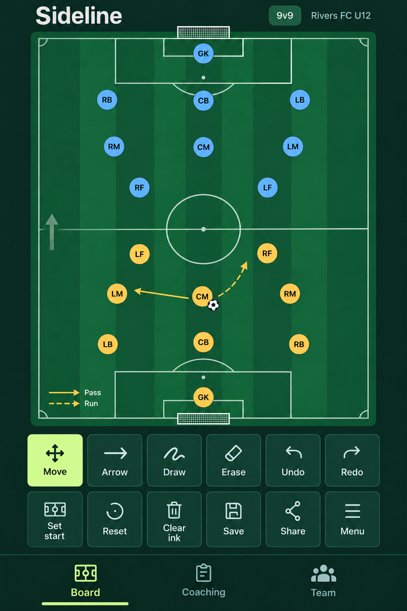
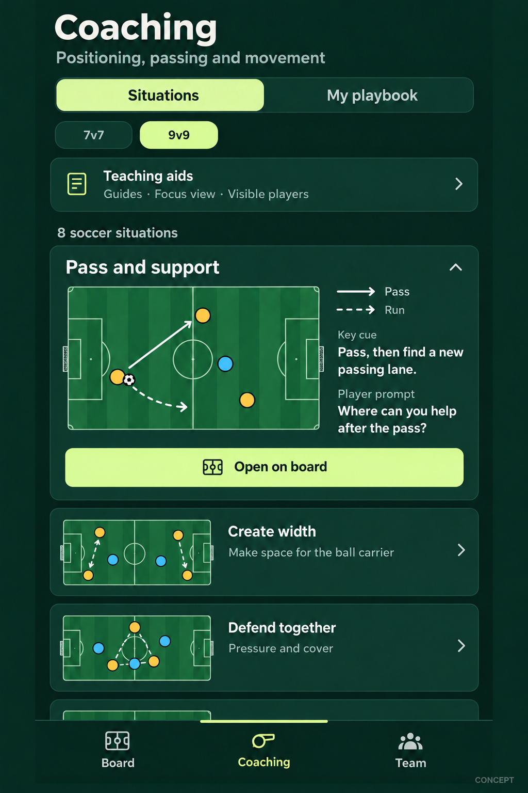
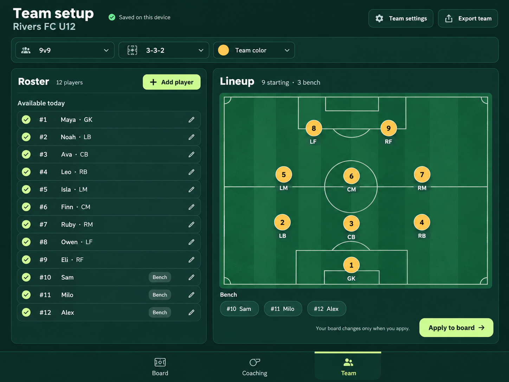

# Sideline proposed Board Coaching and Team screens

Three UI concepts for the app structure requested October 26, 2026, created before implementation with the built-in image_gen tool. Rivers FC U12 and all player names are fictional examples. The local v0.5 implementation now has [actual app screenshots and verification](../../verification/2026-10-26/README.md).

## Board

The default workspace keeps the pitch, moving and passing, drawing, history, Set start, Reset, Save and Share close to hand. Coaching and roster management each have their own labelled tab. Portrait phones use a bottom tab bar; compact landscape-phone placement will be checked during implementation.

## Coaching

Situations and My playbook live in Coaching. Teaching aids configure guides, focus views and player visibility. Each situation provides a short cue and player question; Open on board sends its editable starting setup to the separate Board workspace.

The displayed titles, cue, diagrams and eight-situation count are visual placeholders. They have not been approved as teaching content. The [youth coaching content standard](../../../docs/COACHING_CONTENT_STANDARD.md) governs source selection, age and activity-size details, attribution and acceptance status. The implemented library includes five verified FIFA-linked illustrations, age filtering and Source and adaptation details; unsourced concepts are excluded.

## Team

Team Setup holds the profile, format, colors, roster, availability and planned lineup. The tablet concept shows roster and lineup side by side; phones use Roster and Lineup subviews. The sample has twelve available players, nine starters in a 3-3-2 shape including the goalkeeper, and three bench players. Apply to board previews and applies the chosen lineup explicitly.

## Plans and generation prompts

- [Coaching and navigation plan](../../../SOCCER_PLAN.md)
- [Team setup and management plan](../../../TEAM_PLAN.md)
- [Youth coaching content standard](../../../docs/COACHING_CONTENT_STANDARD.md)
- [Image generation prompts](IMAGE_PROMPTS.md)

The plan text defines behavior and acceptance. The concepts show the intended hierarchy and appearance; interactive layout, gestures, persistence and physical-device use are implementation checks.
