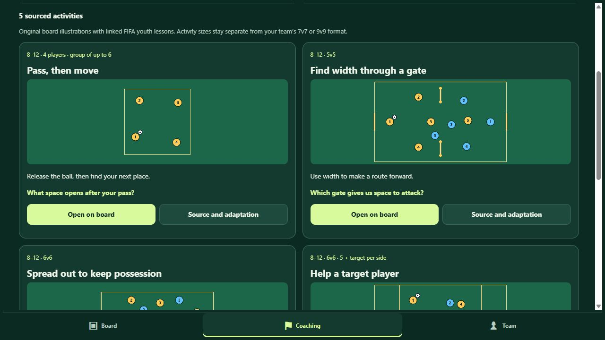
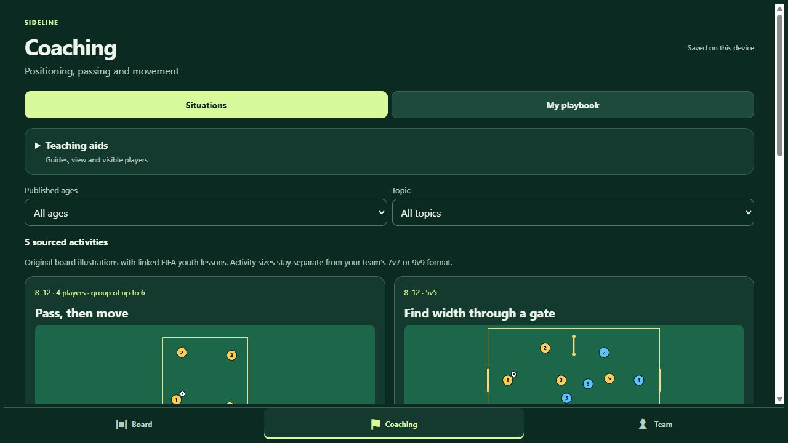

# Sideline v0.5 implementation verification

Verified October 26, 2026 against changes based on `77ba65d`, with service-worker cache `sideline-v0.5.1`. This record initially covered local implementation. The user subsequently authorized GitHub Pages publication for phone testing. The [runtime SHA-256 manifest](runtime-sha256.json) identifies the exact runtime files; these hashes cover file bytes, not human acceptance. Deployment evidence is recorded separately below.

## Implemented scope

- Persistent Board, Coaching and Team tabs; switching workspaces preserves the active board and history.
- Five original activity illustrations, A01–A05, based on four verified FIFA youth publications. Published ages, native activity conditions, direct source links and adaptation limits are visible. Unsourced starting-shape, prescribed-triangle and goalkeeper-build-out lessons are excluded; FA candidates remain outside the runtime pack.
- Teaching guides, half-field views, visibility controls, Pass/Run arrows and activity cues; practice illustrations keep their native player counts and markings.
- Local board/start recovery, named playbook entries, thumbnails, search, favorites, rename/copy/delete and validated editable JSON import/export. Original numeric save slots remain readable.
- Multiple teams, roster editing, optional roles, availability, manual starting assignments, bench, named lineups, explicit short-handed setups and previewed, undoable Apply to board. Team-file copies receive new stable identities.
- Transactional local persistence and complete-release offline caching.

## Automated checks

`node --test --test-reporter=spec tests/*.test.cjs` passed **37/37 checks**. Syntax checks passed for `app.js`, `workspace.js`, `data.js` and `storage.js`.

Coverage includes the original movement, passing, label and offline checks; native sourced activity counts and metadata; activity/start/reset/history; import rejection and legacy migration; team identity, swaps, availability, bench and lineup validation; cross-format application and Undo/Redo; hidden carriers; inverse view coordinates; cancelled-gesture rollback; Pass/Run semantics; transaction abort after request success; copied saved lineups; and rejecting an entire invalid playbook import.

A real browser offline reload from `#coaching` exposed an anchor-sensitive cache lookup. A worker regression reproduced the failure before the fix. Normalizing both the URL search and hash made the regression pass; a fresh cached browser then reloaded and saved an activity with its server stopped.

## Browser evidence

The in-app browser exercised the actual local app:

- All five activity cards, published-age filtering, the U-10 source/adaptation dialog, opening an activity and its captured start.
- A fictional Preview FC roster of 12 players, nine assignments and three bench players; Apply to board preview, application and Set start.
- Named playbook saving, reload recovery of board/start and team data, a named lineup and team duplication.
- An actual editable board JSON download, inspection of its version/format/player/start fields, file selection, import preview and successful import. Native file dialogs were unusually slow in this environment.
- Phone portrait 375×667, phone landscape 667×375 and tablet 1024×768 layouts using a fixture containing the real app. Board controls and all three tabs fit; phone Team/Roster/Lineup navigation was exercised. These are desktop-rendered viewport checks.
- A fresh normal service-worker install on a separate local origin. After the server stopped, `#coaching` reloaded with five cards; an activity opened and was saved into My playbook offline. The app reported offline files ready before the server stopped.

Direct app-tab warning/error logs were empty during the final checks. The responsive fixture reported two MutationObserver errors of unidentified origin; the repository contains no MutationObserver usage. Their cause was not established, so this record does not claim a clean fixture console.

## Actual app screenshots

These captures show the implemented app; fictional test-player data is used.

- [Coaching on desktop](coaching-desktop.png)
- [Coaching on phone](coaching-phone.png)
- [Board on phone](board-phone.png)
- [Board in phone landscape](board-landscape.png)
- [Team on phone](team-phone.png)
- [Team on tablet](team-tablet.png)

## Remaining acceptance

Physical iPhone/iPad installation, outdoor touch/readability, keyboard and orientation behavior, native sharing/import, background/relaunch and updates with existing content remain unverified. Independent youth-coach review and on-field teaching acceptance of Sideline's exact illustrations remain pending. Source verification is complete for this pack; it does not establish publisher endorsement or human teaching acceptance.

The loopback preview is available at `http://localhost:8085/?preview=1#coaching` while its local server remains running. The separate offline-test servers were stopped after verification.

## GitHub Pages publication

The user authorized publishing this release for phone testing on October 26, 2026. All 37 automated checks and all six runtime JavaScript syntax checks passed again before publication. Text line endings were normalized to LF and the runtime manifest refreshed; `.gitattributes` keeps those exact bytes across Windows and hosted checkouts.

- **Release commit:** [`7d69e5b203fa90b468b9f3c679deb4257fc5dd67`](https://github.com/darthreckoner/Sideline/commit/7d69e5b203fa90b468b9f3c679deb4257fc5dd67), based on `77ba65d45d20e79d9728051d626c6388f2c2dd62`. The remote Git tree exactly matched the staged release tree.
- **Deployment:** [Pages run 40415389881](https://github.com/darthreckoner/Sideline/actions/runs/40415389881) completed successfully at 22:50:05 UTC on October 26, 2026.
- **Hosted files:** all 14 runtime files returned HTTPS 200 and matched the release manifest's SHA-256 values. This verification used cache-busting URLs; the ordinary root URL was separately exercised in the browser.
- **Browser:** the previous cached app appeared on the first visit, downloaded the update, and activated v0.5 after the sole Sideline tab was closed and reopened. The ordinary public URL then displayed Board / Coaching / Team, all five sourced activities and Team setup. Menu reported “Offline files ready on this device.” Hosted app warning/error logs were empty during these checks.
- **Live URL:** [Sideline](https://darthreckoner.github.io/Sideline/). If an installed copy shows the old interface, open online, close all Sideline browser tabs and app windows, then reopen. Do not clear browser storage to update: local boards and teams live there.

A follow-up documentation commit records this deployment and its screenshot without changing runtime files. Physical-phone acceptance remains for the user's phone test; independent youth-coach and on-field acceptance remain pending.
