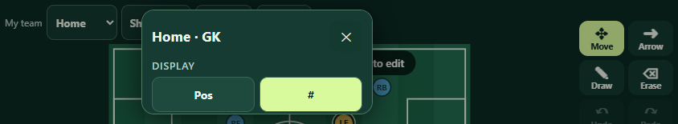
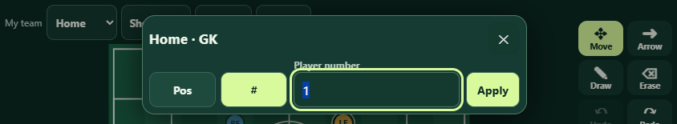
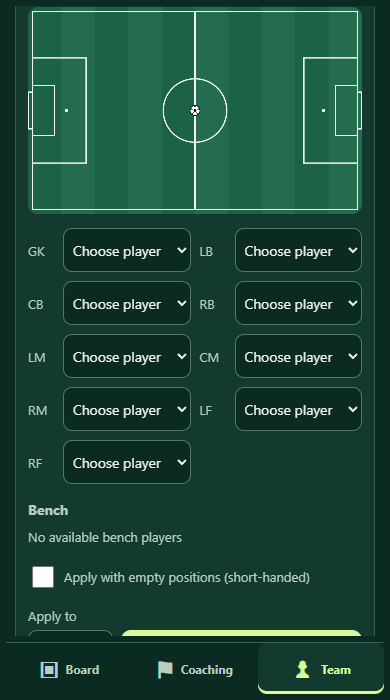

# Mobile scrolling and player editor — local v0.5.10

Status: implemented and verified locally; release-card approval and publication pending. These checks use desktop Chrome with touch emulation and replayed visual-viewport events. Native iPhone keyboard, browser chrome and rotation acceptance remain open.

## Reproduction and causes

1. Team → Lineup: an upward swipe starting on the preview field left `#team-view.scrollTop` unchanged at 374. The global `canvas { touch-action: none; }` rule consumed preview gestures. Restricting that rule to `#board` makes the first swipe scroll the assignments into view while preserving board dragging.
2. Board → hold a player → #: shrinking the visible viewport to 844 × 155 left the focused number below the dialog's visible scroll area. The existing viewport listener resized the outer dialog but retained the tall form layout. A compact form for short, wide viewports now puts Pos/#, the number and Apply on one row. The dialog also keeps its focused control visible during viewport resize/pan events and bounds itself to the available width and height.

The regression command below failed both symptom checks before the fixes. Applying the touch-action change alone fixed scrolling while the keyboard check still failed. Both fixes together passed.

## Checks

- `node --test tests/*.test.cjs`: all 60 checks passed after the runtime changes and release/cache bump.
- `node tests/mobile-layout.browser.cjs`: all 12 browser checks passed, with no page errors.
- Touch swipes on lineup previews: 320, 390 and 430 pixel portrait widths.
- Board touch drag and Undo; a stationary touch hold opens the player editor.
- Number input visibility and Apply reachability with landscape visual viewports of 844 × 155, 667 × 130, 844 × 190 (40 pixel top offset), and 932 × 155 (25 pixel top offset).
- Rotation to portrait with the number focused; closing the keyboard restores the full editor. Applying 29 changes the selected player's label.
- Fresh service-worker installation, offline reload, recovery of the saved number, and a first-swipe lineup scroll while offline.
- JavaScript syntax and `git diff --check` passed.

The browser check serves the working tree on an ephemeral loopback port and closes its browser and server afterward. It requires Playwright and installed Chrome; the application itself remains dependency-free. On this machine:

```powershell
$env:NODE_PATH = 'C:\Users\Justin Rutledge\.cache\codex-runtimes\codex-primary-runtime\dependencies\node\node_modules'
node tests/mobile-layout.browser.cjs
```

Set `SIDELINE_EVIDENCE` to a writable folder to capture screenshots. The keyboard screenshots below are cropped to the simulated visible area above the keyboard; the native keyboard is not rendered by desktop emulation.

| Before | After |
| --- | --- |
|  |  |



## Pending release card

Version 0.5.10

- Scroll over the lineup field to reach the player list below it without getting stuck.
- Edit player numbers in landscape with the number field and Apply button above the keyboard.

`releases.js` retains the published 0.5.9 entry. The pending entry and `sw.js` cache version both use 0.5.10. Existing README/CONTEXT edits containing the user's release-card approval rule were preserved. No commit, push or publication was performed.

Before physical-device acceptance: on the updated iPhone app, open Team → Lineup and swipe up from the field on the first attempt. Then hold a Board player, rotate to landscape, choose #, enter a number, and Apply with the native numpad open; dismiss and reopen the editor, then rotate back to portrait.
